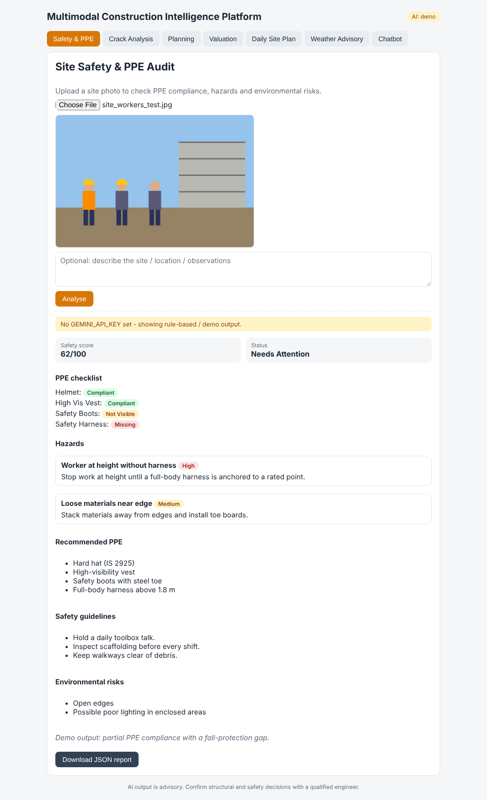
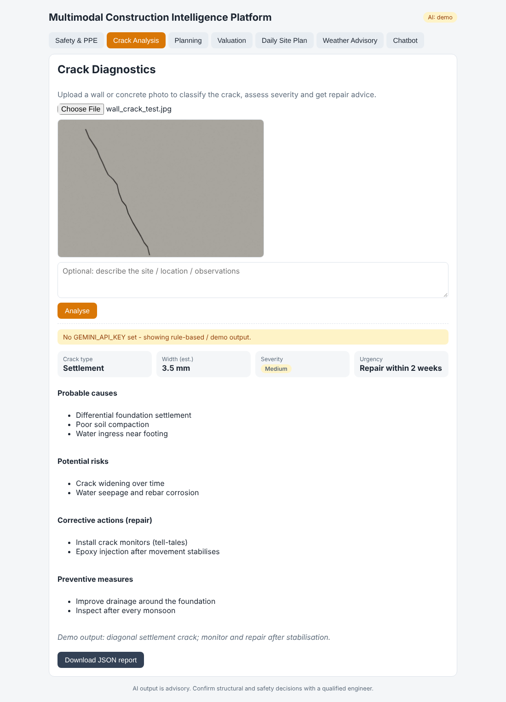
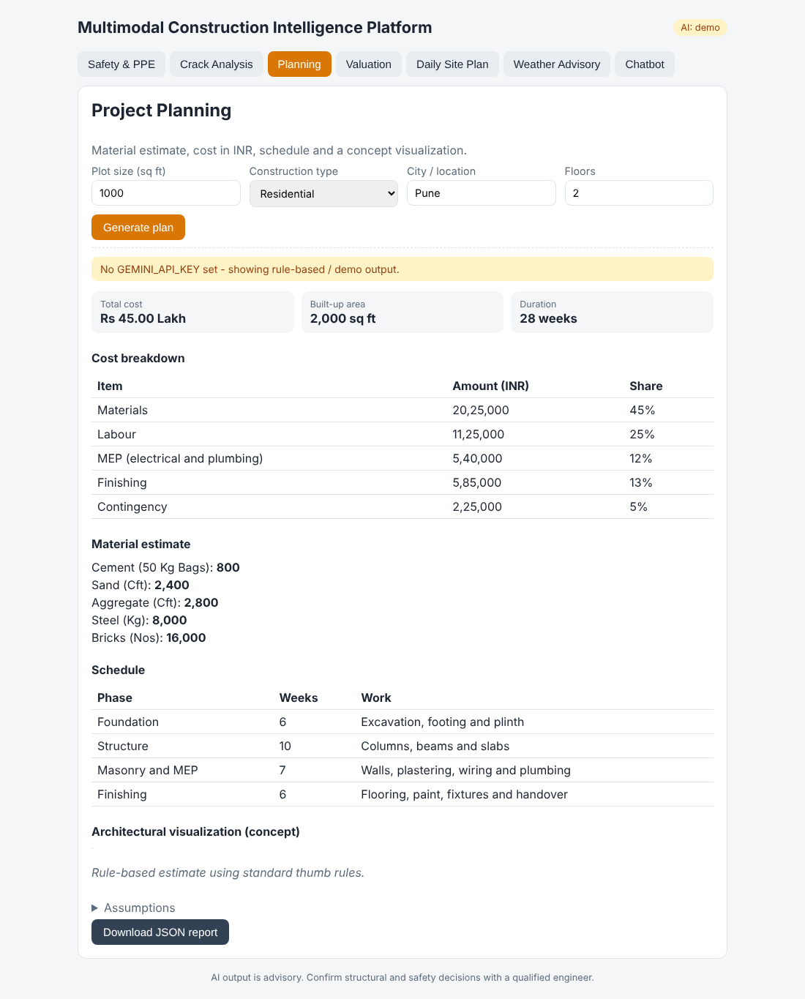
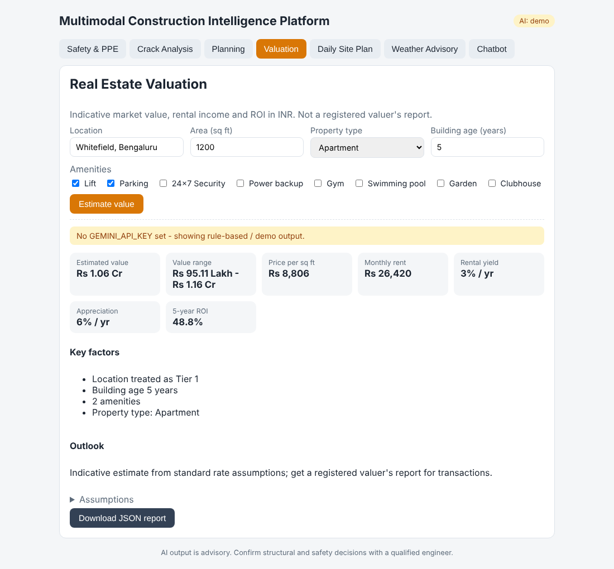
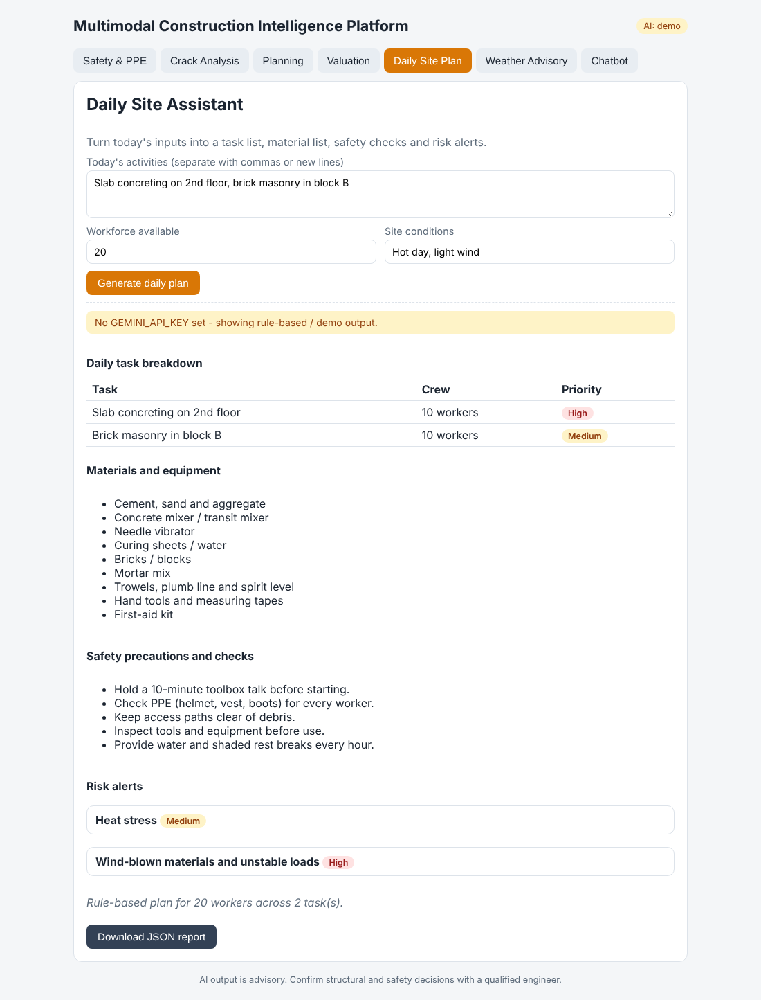
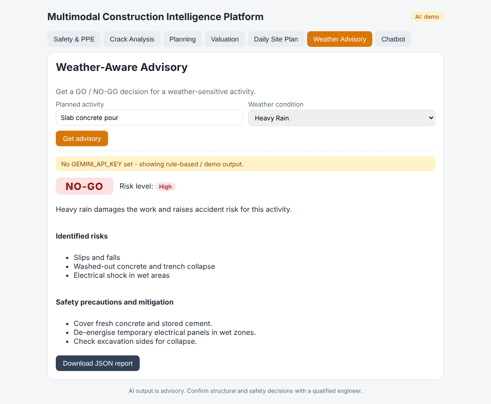
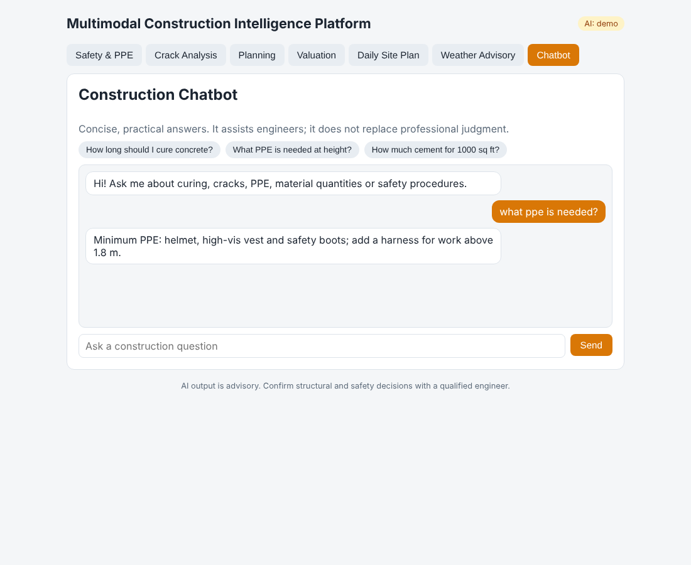

# Multimodal Construction Intelligence Platform

AI-powered decision-support system for construction professionals. It analyses **site images, text descriptions and structured project data** and returns structured, actionable results.

**Stack:** React 18 + Vite (frontend) | FastAPI + Pydantic (backend) | Google Gemini multimodal LLM (`google-genai`) | Pillow

## Features (7 tabs)
| Tab | Input | Output |
|---|---|---|
| Safety & PPE | Site photo and/or text | Safety score, PPE checklist, hazards with severity and remedies, recommended PPE, safety guidelines, environmental risks |
| Crack Analysis | Wall / concrete photo and/or text | Crack type, width, severity, urgency, probable causes, potential risks, repair actions, preventive measures |
| Planning | Plot size, construction type, city, floors | Material estimate (cement, sand, aggregate, steel, bricks), cost breakdown in INR, phase schedule, AI architectural visualization |
| Valuation | Location, area, property type, building age, amenities | Value range, price per sq ft, monthly rent, rental yield, appreciation, 5-year ROI |
| Daily Site Plan | Today's activities, workforce, site conditions | Task breakdown with crew, materials and equipment, safety precautions, risk alerts |
| Weather Advisory | Planned activity and weather condition | **GO / NO-GO**, risk level, risks, precautions and mitigation |
| Chatbot | Construction question | Short practical answer; asks a clarifying question when the query is vague |

## Architecture
```
React (Vite) --JSON / multipart--> FastAPI --> centralized AI layer (run_ai -> _generate_json) --> Gemini
                                      |                  |
                                      |                  +-- shared system prompt + FEATURE identifier on every request
                                      |                  +-- retry on 503/429, then a backup model
                                      +-- lenient Pydantic schemas (safe defaults) + rule-based fallback
```
* **One AI layer for every feature.** Each request carries `FEATURE: <name>` so the model applies the right reasoning (safety, crack, planning, valuation, daily plan, weather, chatbot).
* **Strict JSON contracts.** Every answer is validated by a Pydantic schema. Missing or malformed fields get safe defaults; wrong enums, numbers-as-text and junk list items are normalised, so the UI never receives `undefined`.
* **Consistent numbers.** Totals, price per sq ft, rental yield and ROI are recomputed on the server from the AI's raw values; implausible results (for example Rs 50/sq ft) trigger the fallback.
* **Always an answer.** With no API key, an AI error or an empty answer, the API returns a clearly labelled rule-based result (`mode: "demo"` plus a warning).
* **Frontend safety.** All list rendering uses safe array helpers, an error boundary wraps every tab, and loading / error states are handled.

## Run locally
Requirements: Python 3.9+, Node.js 18+, Git.

```bash
# 1. Backend
cd backend
python -m venv .venv && source .venv/bin/activate   # Windows: .venv\Scripts\activate
pip install -r requirements.txt
cp .env.example .env        # Windows: copy .env.example .env, then add GEMINI_API_KEY
python -m uvicorn main:app --reload --port 8000

# 2. Frontend (new terminal)
cd frontend
npm install
npm run dev                 # http://localhost:5173
```
Without a `GEMINI_API_KEY` the app runs in **demo mode** (header badge "AI: demo"). The key lives only in `backend/.env` (git-ignored) and never reaches the browser.

If the banner says `NotFound`, your key cannot use that model. List the models your key can use and put one in `GEMINI_MODEL`:
```bash
python -c "import os,requests; from dotenv import load_dotenv; load_dotenv(); r=requests.get('https://generativelanguage.googleapis.com/v1beta/models', params={'key':os.getenv('GEMINI_API_KEY'),'pageSize':1000}); [print(m['name']) for m in r.json().get('models',[]) if 'generateContent' in m.get('supportedGenerationMethods',[])]"
```

## API
| Method | Endpoint | Input |
|---|---|---|
| GET | `/api/health` | - |
| POST | `/api/safety` | multipart: `image` (jpg/png/webp, max 8 MB), `description` |
| POST | `/api/cracks` | multipart: `image`, `description` |
| POST | `/api/planning` | JSON: `plot_size_sqft`, `construction_type`, `city`, `floors` |
| POST | `/api/valuation` | JSON: `location`, `area_sqft`, `property_type`, `building_age_years`, `amenities[]` |
| POST | `/api/daily-plan` | JSON: `activities`, `workforce`, `site_conditions` |
| POST | `/api/weather-advisory` | JSON: `activity`, `condition` (Normal / High Wind / Heavy Rain / Extreme Heat / Thunderstorm / Dense Fog) |
| POST | `/api/chat` | JSON: `message`, `history` |

Interactive docs: http://localhost:8000/docs

## Testing
```bash
cd backend && python -m pytest -q      # 56 tests
cd frontend && npm run build           # production build check
```
Covered:
* **Functional / schema:** every endpoint in demo mode and through a fake live-AI client (system prompt and FEATURE id sent per feature, partial output gets defaults, wrong types are normalised, empty or non-JSON output falls back).
* **Edge cases:** missing input, wrong file type (415), empty / truncated / tiny images (422), negative or out-of-range numbers, unknown enum values, empty chat message, vague chat query.
* **Numbers:** totals recomputed from the breakdown, ROI and yield formulas, implausible costs / prices rejected, repeated calls give identical fallback numbers, city tier changes cost, age and amenities change value.
* **AI resilience:** retry on 503, backup model on permanent error, graceful demo output after all attempts fail.
* **End-to-end (browser):** all 7 tabs, empty submit, tiny image, negative input, GO / NO-GO rules, chatbot and phone-width layout were exercised with Playwright (15 checks).

## Screenshots
Captured in demo mode (no API key). Retake them from the live site for the final submission.

| | |
|---|---|
|  |  |
|  |  |
|  |  |
|  | |

## Deployment
- **Backend (Render, free):** root `backend`, build `pip install -r requirements.txt`, start `uvicorn main:app --host 0.0.0.0 --port $PORT`. Env vars: `GEMINI_API_KEY`, `GEMINI_MODEL`, `CORS_ORIGINS=https://<your-frontend>.vercel.app`.
- **Frontend (Vercel):** root `frontend`, framework Vite. Env var: `VITE_API_URL=https://<your-backend>.onrender.com`.

## Known limitations and future work
- AI output is advisory. Crack width, PPE status and valuation come from a general multimodal LLM, not a calibrated vision model or a registered valuer.
- The PPE checklist gives one status for the whole photo, not per worker.
- Fallback (demo) calculations use fixed rule-of-thumb rates and a small city-tier list; unknown cities default to Tier 2.
- Weather condition is selected by the user; live weather data is not fetched.
- Architectural image uses the public Pollinations service and may be slow or unavailable.
- Render free tier sleeps after inactivity (first request can take about 50 s). Gemini may return 503 under high demand; the app retries and then falls back.
- No accounts or database; nothing is stored. Future work: per-worker PPE detection, live weather API, PDF report export, project history.
